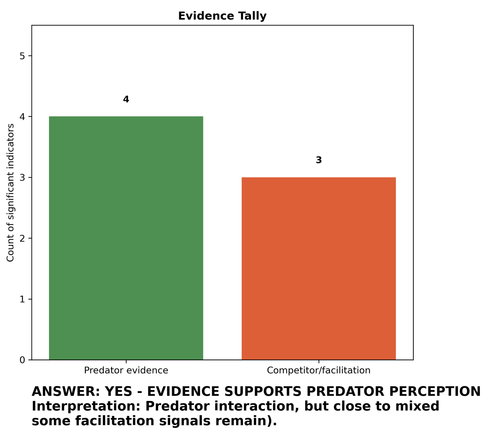
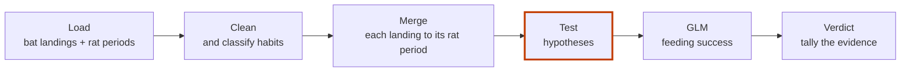
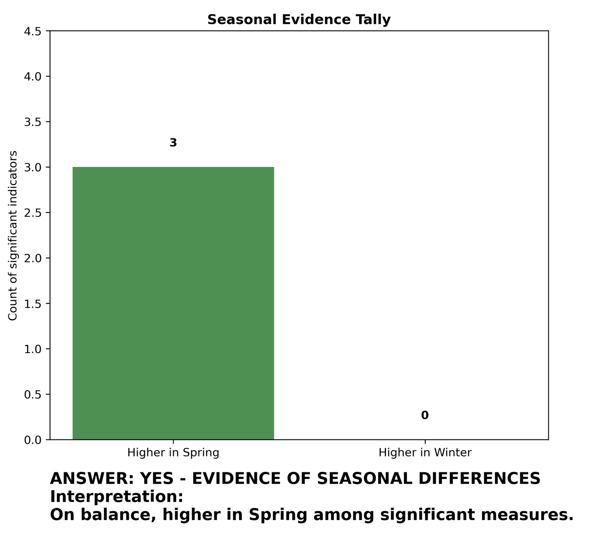

# Bat vs Rat: HIT140 Data Science Investigations

[](https://www.python.org/)
[](https://pandas.pydata.org/)
[](https://www.statsmodels.org/)
[](LICENSE)

**Two Python analyses of field data ask whether fruit bats treat rats as predators, and whether their behaviour changes between winter and spring.**



*Investigation A: 4 results point to predator, 3 to competitor. From `Investigation A/plots/`.*

A bat lands on a food platform. A rat arrived there four minutes ago.
Does the bat wait longer before it eats? Does it eat less often?
If so, it treats the rat as a danger, not only as a rival for food.

- **What it does:** links 907 bat landings to 2,123 half-hour records of rat activity, then tests 8 hypotheses (A) and 6 seasonal comparisons (B).
- **How it is measured:** Spearman correlations, Mann–Whitney U and Fisher exact tests (B with FDR correction), and binomial GLMs for feeding success.
- **What it found:** A leans to "predator", but close to mixed. B finds 3 of 6 measures higher in spring and none higher in winter.

Group project (Group 31, four students) for HIT140 Foundations of Data Science, Charles Darwin University, 2025.
Investigation A also has its [slides and a recorded presentation](Presentations/Investigation%20A/).

## Quick start

Nothing to install to see the results: every chart is in `Investigation A/plots/` and `Investigation B/plots/`.

To run it yourself:

```bash
git clone https://github.com/Estaed/HIT140_Assessment.git
cd "HIT140_Assessment/Investigation A"
pip install pandas numpy matplotlib seaborn scipy scikit-learn statsmodels
python investigation_A.py
```

For Investigation B, run `python investigation_B.py` from the `Investigation B` folder.
Run each script from its own folder: it reads `dataset1.csv` and `dataset2.csv` there.
Charts are saved to that folder's `plots/`; cleaned and merged data go to `datasets/`.
Each chart also opens in a window; close it to let the script go on.

## How it works



1. **Load.** `dataset1.csv` has one row per bat landing. `dataset2.csv` has one row per 30-minute period with rat activity.
2. **Clean.** Fix vigilance times under one second and sort each `habit` into a standard category.
3. **Merge.** `merge_asof` links each landing to the most recent 30-minute period before it.
4. **Test.** A: does each threat measure go with more vigilance or less success? B: does each measure differ between Winter and Spring?
5. **Model.** Binomial GLMs for feeding success with the threat measures and controls. B adds a season term and season interactions.
6. **Verdict.** Each significant result is labelled and counted. The final chart gives the answer.

The three threat measures are proximity (seconds since the rat arrived), intensity (`rat_minutes`) and frequency (`rat_arrival_number`).

## Results

**Investigation A: do bats perceive rats as predators?**
7 results were significant: 4 point to predator, 3 to competitor or facilitation.
The script's verdict: yes, predator perception, but close to mixed.

| Hypothesis | Verdict |
|---|---|
| H1 Proximity → Vigilance | Competitor/facilitation |
| H2 Intensity → Success | Competitor/facilitation |
| H3 Frequency → Vigilance | Not significant |
| H4 Frequency → Success | Predator evidence |
| H5 Threat → Risk-taking | Not significant |
| H6 Threat → Defensive behaviour | Not significant |
| H7 Time of night (control) | Contextual |
| H8 Composite threat → Vigilance | Not significant |

The other 4 of the 7 come from the GLM on feeding success.
Proximity, frequency and defensive behaviour are labelled predator evidence; intensity is labelled competitor.

**Investigation B: do behaviours change between Winter and Spring?**



| Measure | Verdict |
|---|---|
| H1 Rat arrivals (`rat_arrival_number`) | No seasonal difference |
| H2 Rat presence (`rat_minutes`) | Higher in Spring |
| H3 Vigilance (`bat_landing_to_food`) | Higher in Spring |
| H4 Feeding success (`reward`) | Higher in Spring |
| H5 Risk (0/1) | No seasonal difference |
| H6 Defensive behaviour (0/1) | No seasonal difference |

Verdicts are from the Phase 4 and Phase 6 charts in each `plots/` folder.

<details>
<summary>The data: where it comes from and what the columns mean</summary>

The course brief (`Project and Data Brief v.1.pdf`, in each investigation folder) describes the data.
Zoologists filmed Egyptian fruit bats and black rats on a food platform in a semi-natural bat colony over 7 months.

- **Dataset1** (`dataset1.csv`, 907 rows): individual bat landing events with detailed behavioural measures, such as `bat_landing_to_food` (vigilance, in seconds), `habit`, `risk`, `reward` and `seconds_after_rat_arrival`.
- **Dataset2** (`dataset2.csv`, 2,123 rows): 30-minute environmental periods with rat activity context, such as `rat_minutes`, `rat_arrival_number`, `food_availability` and `bat_landing_number`.

Both investigations use the same two files.

The Investigation A README cites the GLM method source: Chen, X., Harten, L., Rachum, A., Attia, L., & Yovel, Y. (2025). Complex competition interactions between Egyptian fruit bats and black rats in the real world. Mendeley Data, V2. https://data.mendeley.com/datasets/gt7j39b2cf/2

</details>

<details>
<summary>Investigation A in detail: phases, hypotheses and output files</summary>

Non-seasonal analysis of predator versus competitor signals.
Approach: behavioural classification, threat–response correlations, hypothesis testing (8 hypotheses) and GLMs.

**Phases**

- Phase 1: data overview and loading
- Phase 2: classification summary and data cleaning
- Phase 3: threat distributions and behavioural outcomes
- Phase 3.1: IQR analysis and correlation mapping
- Phase 4: hypotheses overview (threat to responses), with Spearman correlations
- Phase 5: GLM effects on feeding success
- Phase 6: final summary and verdict

**Hypotheses**

1. **H1** Proximity → Vigilance: bats are more vigilant when rats arrived recently.
2. **H2** Intensity → Success: more rat minutes lower feeding success.
3. **H3** Frequency → Vigilance: more rat arrivals raise vigilance.
4. **H4** Frequency → Success: more rat arrivals lower feeding success.
5. **H5** Risk-taking drops under higher threat (proximity, intensity, frequency).
6. **H6** Defensive behaviours (cautious, slow approach, fight) rise with threat.
7. **H7** Time of night: a control for temporal effects, not a predator test.
8. **H8** A composite threat index predicts more vigilance.

**Output files**

- `datasets/dataset1_cleaned.csv`, `datasets/dataset1_merged_with_dataset2.csv`
- `plots/Phase1_Data_Overview.png` to `plots/Phase6_Final_Summary_and_Verdict.png` (7 charts)

Full notes: [`Investigation A/README.md`](Investigation%20A/README.md).

</details>

<details>
<summary>Investigation B in detail: seasons, tests, models and output files</summary>

Seasonal analysis: Winter versus Spring.
The brief says that in winter food is scarce and rats come less often; in spring food is plentiful and rats come more often.
The season (`season_label`) comes from the month of each landing.

Approach: seasonal EDA, Mann–Whitney U and Fisher exact tests with FDR correction (Benjamini–Hochberg), and GLMs with season and interaction terms.
Each measure is reported as "Higher in Spring", "Higher in Winter" or "No seasonal difference", with a final tally and interpretation.

**Phases**

- Phase 1: data overview and loading
- Phase 2: classification summary and data cleaning
- Phase 3: seasonal distributions and behavioural outcomes
- Phase 3.1: IQR analysis and correlation mapping
- Phase 4: seasonal hypotheses overview (Winter vs Spring)
- Phase 5: GLMs for feeding success (binomial, with season terms) and rat arrivals (Poisson, with season × hours)
- Phase 5.1 to 5.4: seasonal model comparison, OLS regression, simple linear regression, predator perception analysis
- Phase 6: final seasonal summary and verdict

**Output files**

- `datasets/dataset1_cleaned.csv`, `datasets/dataset1_merged_with_dataset2.csv`
- `plots/Phase1_Data_Overview.png` to `plots/Phase6_Final_Summary_and_Verdict.png` (11 charts)

Full notes: [`Investigation B/README.md`](Investigation%20B/README.md).

</details>

<details>
<summary>Repository layout and requirements</summary>

```
Investigation A/   non-seasonal analysis: predator vs competitor signals
Investigation B/   seasonal analysis: Winter vs Spring
Presentations/     slides and video for Investigation A
```

Each investigation folder holds its script, the two source CSVs, the course brief, `datasets/` and `plots/`.

Requirements: Python 3.x with pandas, numpy, matplotlib, seaborn, scipy, scikit-learn and statsmodels.

</details>

## Licence

[MIT](LICENSE).
